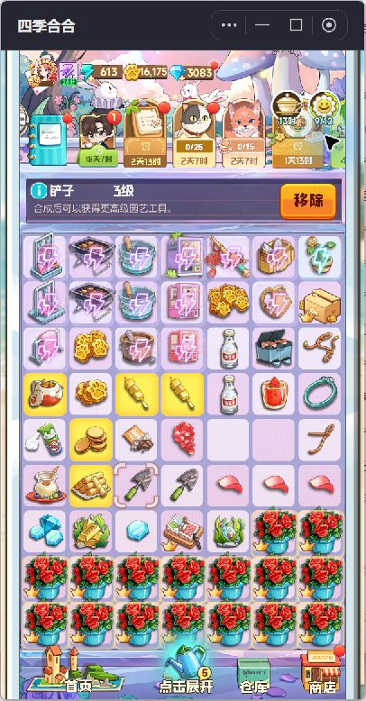
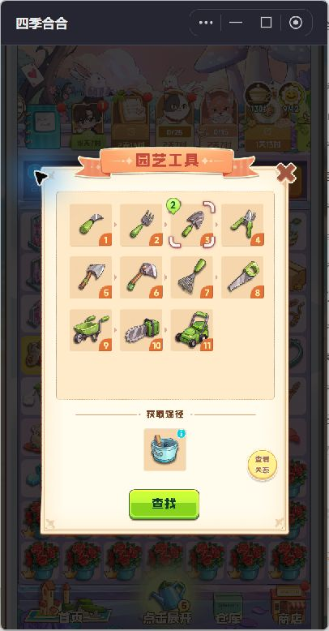
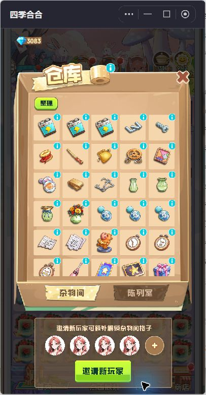
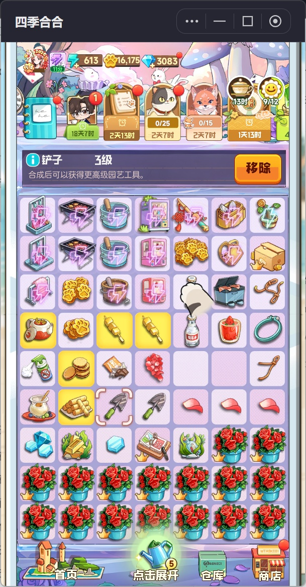
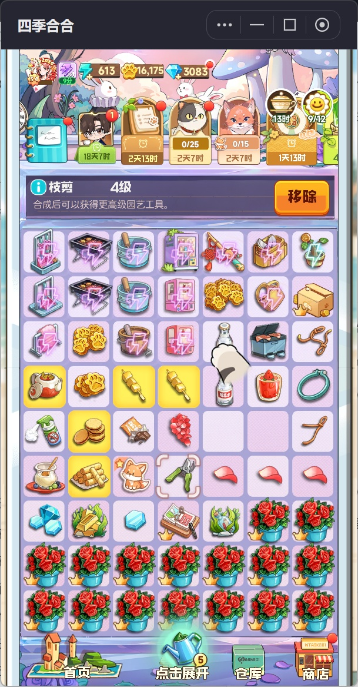

# 四季合合试玩收获与棋盘优化建议

日期：2026年10月16日。对象：抖音小游戏《四季合合》，以及当前项目的正式棋盘实现和六代玩法设计。

最值得借鉴的是物品的可理解性：选中后看到名称、等级和下一步，进入合成链后看到完整成长路径、持有数量和获得途径。当前项目已经具备合成操作和自动供货基础，优先应把订单需求、商品合成链、可供货发射器接成一条操作路径，再改善并行订单可见性与等待反馈。

## 实际试玩范围

通过本机抖音桌面客户端的「小游戏 → 最近玩过 → 四季合合」进入，实际运行的小游戏标识为 `tt210457b9be35faff07`。使用已有进度账号，没有重置存档；这次体验不代表新玩家开局流程，也不等同于手机真机触控验收。

首次试玩完成了进入主场景、打开主棋盘、选中商品、两次工具取物、查看合成链与获得途径、使用查找入口、查看仓库和建设任务。前两次尝试未成功拖放；同日用户指定使用 Python 后，已真实完成「两把三级铲子 → 一件四级枝剪」。**随后由用户备齐普通订单的贡丸串，已真实提交并确认商品消耗、金币到账与剩余订单衔接。** 合成与普通交单两个阶段均有实机证据，但并非由助手独立完成同一件交付商品的全部备货过程，不能将用户的准备操作归为本轮自主试玩。

首次试玩结束时，界面工具因「无法足够可靠地确定当前 Windows 浏览器地址以执行策略检查」停止自动操作；该次试玩随即停止界面输入。同日用户明确要求继续后，重新识别并操作了原小游戏窗口，过程见下方续玩记录。项目对比初期依据设计文档与代码审查；普通交单补测后，已在 Chrome 实走独立合成测试端并做限定改动，正式抖音运行端未修改、未验收。

## 已验证的操作与收获

| 操作 | 实际观察 | 对项目的启发 |
|---|---|---|
| 进入游戏与主棋盘 | 连续遇到活动通知、活动结算、奖励展示、礼包和活动引导；进入棋盘后仍有活动浮层 | 回归玩家应尽快回到可操作棋盘；活动入口不应抢占合成与交单的操作时机 |
| 查看主棋盘 | 主棋盘为7列9行；顶部有资源和多张活动入口，信息条在格子上方，场景、仓库等入口在底部 | 保留棋盘的连续操作区域；顶部目标和选中详情需要稳定，外围活动数量不宜直接照搬 |
| 选中商品 | 「面筋 3级」「铲子 3级」等名称、等级显示在固定信息条，普通物品同时出现「移除」按钮；匹配物品有提示表现 | 让玩家知道拿起的是什么、能做什么；详情位置固定，避免每次追着不同浮层找信息 |
| 工具取物 | 先选中「简易工具桶 6级」，随后两次点击各生成一把三级铲子；体力由621变617，再变613 | 取物应同时给出明确结果、资源变化和落点反馈。本次界面标示为x4取物模式，不能把每次消耗4点当作所有状态下的基础规则 |
| 查看合成链 | 「园艺工具」面板展示1至11级图像，当前三级被标记，持有数量显示为2，下方有工具桶获得途径和查找入口；工具桶自身的合成链还出现未发现问号 | 合成链应解决「现在有什么、还差哪一级、从哪里来」，而不仅是展示收藏图标 |
| 使用查找 | 点击园艺工具面板的「查找」后返回棋盘，同级铲子的提示仍可见 | 查找应回到操作现场。本次没有证明该按钮能定位生成器，项目的「定位供货线」属于进一步设计建议 |
| 查看仓库 | 看到了「整理」、物品格、「杂物间／陈列室」和邀请扩格入口 | 竞品确实存在盘外存放，但当前项目已明确取消商品回仓与暂存，不建议为了相似度重新加入这套负担 |
| 查看建设任务 | 「岛屿建设」面板呈现当前区域、进度和所需金币 | 长期目标可用于解释赚金币的用途；项目应对应工厂投资与顾客成长，保持自己的经营主题 |

本轮未购买礼包、未主动支出金币或钻石、未移除商品。领取了已结束活动的25点体力，并为上述两次取物合计消耗8点体力；已有棋盘因此多出两把三级铲子。

### 实机截图

## 同日续玩记录

本次目标是补齐合成与交单流程，实际继续操作同一账号、同一主棋盘，没有重新开档，也没有把其他游戏或本地原型当作竞品实玩。

| 尝试 | 核对结果 |
|---|---|
| 重新识别小游戏窗口并核实应用标识 | 确认仍为 `tt210457b9be35faff07` 的《四季合合》 |
| 使用新截图坐标拖合第6行第3格和第4格的两把三级铲子 | 出现选中和触点反馈，随后稳定画面仍有两把铲子；未生成四级工具 |
| 切换全屏后按放大后的棋盘重新取坐标 | 两把铲子仍未合成，不能把触点或高亮动画视为成功 |
| 将铲子较长距离拖往空格 | 稳定画面中来源与空格均未改变，没有验证成功移动 |
| 先点击并确认鼠标位于起点，再执行相邻拖合 | 结果仍为两件三级铲子；物品数量、等级和占格未发生预期变化 |
| 使用滚轮尝试浏览顶部任务卡 | 未得到任务栏成功滚动的证据，也未完成普通订单交付 |

本次观察到体力613、金币16175、钻石3083均未改变，没有额外取物、删除商品或购买内容。结束时退出全屏，恢复原窗口状态。

该次使用的电脑操作接口提供一次性 `drag`，没有已文档化的拖动时长、路径步数或独立鼠标按下／抬起参数。上述失败不能证明游戏自身不支持拖放，也不足以确认具体原因；没有使用改存档、调用内部结算接口或模拟项目模型来替代真实合成与交单。**该次未完成合成；其后改用 Python 已成功，详见下节。**

## 使用 Python 完成真实合成

用户明确要求使用 Python 后，改用 Windows 的鼠标输入接口操作原有小游戏窗口。先校准 DPI 并获取609×1167的实际窗口截图，再将鼠标移到第6行第3格的三级铲子，按住左键约0.4秒，在约1.5秒内分60步移动至第4格，短暂停留后松开。输入过程中检查目标窗口仍在前台，并确认 Windows 左键保持按下；这是真实界面操作，没有调用游戏内部接口或修改存档。

**已确认的结果：两把三级铲子消失，第6行第4格生成一件「枝剪 4级」，并保留选中状态。** 固定信息条随后稳定显示「枝剪 4级」，确认依据是物品形态、等级和数量变化，而不是触点或发光动画。

这次合成前后，体力613、金币16175、钻石3083均未改变。原来源格同时出现狐狸活动道具，因此这次操作没有净释放一个空格；未点取该道具，也未核实它的最终兑换规则。这是本次活动状态下的观察，不推广为每次合成必定掉落道具。

Python 输入与前两次输入方式同时存在 DPI 校准和拖动节奏差异，不能通过本轮对比单独认定其中哪一项是此前失败的唯一原因。

### 继续检查任务入口和建设结算

成功合成后继续检查原先要求的交单流程，但未找到并完成普通商品订单。顶部多个入口实际为限时活动；底部「点击展开」显示的是待领取物品队列，本次看到两个浇水壶、两个箱子和一枚金币图标，共五格，不能把它当作订单列表，也没有从中领取物品。

通过「区域任务 → 岛屿建设」实际完成了一次「清理帐篷藤蔓」：消耗360游戏金币，金币由16175降至15815，场景藤蔓清除，随后出现标示为×145的奖励。**这属于金币建设任务，不是商品交单，也没有消耗刚合成的枝剪。** 体力仍为613，钻石仍为3083。未购买付费内容、未移除商品；建设后回到主棋盘，枝剪仍在。

结算证据：[建设任务费用](16-python-region-task-before.jpg)、[扣除360金币后的界面](18-python-region-task-settled.jpg)、[奖励展示](21-python-region-progress.jpg)、[待领取物品队列](25-python-bottom-drawer.jpg)、[最终棋盘状态](33-python-final-board.jpg)。进度动画的中间数值不作为最终区域完成比例。

### 本次实玩的新增设计收获

- **P0 让操作入口的含义明确。** 活动、区域建设、普通商品订单和待领取物品具有不同作用。项目保留现有导航短标签；新增合成链和来源定位时使用「查看合成链」「定位供货线」等明确入口，不只依赖无标签图标。
- **P2 保留合成结果的定位和等级确认。** 本次枝剪停留在目标格并保持选中，信息条能确认名称与四级结果。项目已有合成选中和动效，继续复用；重点是在目标齐货时同步反馈订单状态，避免活动计数或重复提示压住结果信息。
- **P2 保住合成腾位的收益。** 本次来源格被新活动道具再次占用，合成并未净腾位。项目当前以合成腾位为主要乐趣，不宜直接加入随机活动物占格；空间提示应按实际占格结果计算。
- **P2 将奖励与下一步连接起来。** 建设后能看到场景变化和奖励，但普通商品交单还未验证。项目可在交单到账后提供可选的工厂投资入口，不把连环领奖或强制切场景作为继续合成的前提。

## 发射器动画与手感实测

同日继续操作《四季合合》原账号的「简易工具桶 6级」，位于第1行第3格；保持界面原有x4取物模式。使用 Python 发送真实鼠标按下、保持和松开事件，并以约30帧／秒采集实际窗口画面，同时记录输入和截图时间。以下是桌面鼠标操作与画面观察，不是手机触控延迟、声音或振动测试。触点附近的青色爪印来源未核实，原有大手指也属于引导提示，均不作为发射器自身的按压形变证据。

### 单点 连发与满盘

| 场景 | 输入与资源变化 | 实际动画和操作结果 |
|---|---|---|
| 已选中工具桶后单点 | 按下0.401秒、松开0.567秒，保持约166毫秒；体力613→609 | 增加1把三级铲子，落在第3行第5格。0.706、0.804、1.007秒的选帧可看到在途商品，1.172秒出现白色落地尘效，随后稳定为格内商品；不是只在空格突然出现 |
| 按住连续取物 | 按下0.406秒、松开1.800秒，保持约1.395秒；体力609→597 | 连续增加3把三级铲子，填入第4行第5格、第5行第5格和第5行第6格。约1.006秒的选帧中多件同时在途，不必等上一件落地；1.172秒已出现「棋盘已满」 |
| 满盘再次单点 | 按下0.405秒、松开0.567秒；体力597→597 | 没有新增商品，选帧0.806秒显示「棋盘已满」。本次失败点击没有扣体力，金币与钻石也未改变 |
| 腾位后较短保持 | 按下0.404秒、松开0.767秒，保持约363毫秒；体力597→585 | 增加2把铲子和1件双罐图标物品，再次填满3格；双罐物品未点开核实名称。说明本次生成器并非始终只出铲子，但不据此推导出物概率 |

时间均从各段采集开始计算，不是游戏内部事件时间。单点约166毫秒与保持约363毫秒的结果分别为1件和3件，支持「稍多保持就可能多取」的手感差异；这两次保持均受到有限空格影响，不能据此计算精确起发阈值、连发频率，或断言松手后多发／立即停止。较短保持时，松手后画面仍有在途商品，不等于松手后又产生了新商品。后续已补做有空格余量的释放测试，见下节。未另测快速双击与发射器耗尽。

**手感判断：**实际画面能连续追踪「从工具桶飞出 → 前往目标格 → 白色落地反馈 → 成为可见商品」，出物有过程和完成感；连续取物时允许多件并行，节奏不被逐件落地阻塞。但飞行交叠、全盘闪电提示和活动计数叠加后，逐份计数不够直观。对持续取物的掌控感，应优先通过数量反馈和明确停发原因改善，而不是盲目加快或拉长飞行。

### 针对当前项目的优先建议

1. **P1 先打通源端与落地的反馈链。** 正式端已有240毫秒飞行，不应列为没有动画。优先复用原型已有的出口压伸、库存脉冲和落地轻回弹，使「发出一份、库存少一份、格内落下一份」成为可读的因果链。竞品已验证的是飞行和白色落地反馈，不是其出口压伸或精确缓动参数。依据：[正式飞行](../../../douyin-game/src/application.js#L445)、[正式轨迹](../../../douyin-game/src/renderer.js#L1073)、[原型源端与落地效果](../../../preview/merge-preview/launcher-effects.js#L46)。
2. **P1 保持连发并行，补本次取出数量。** 正式端已具备400毫秒起发、200毫秒间隔，以及长按松手不额外补一份；不要为播完动画而串行锁住取货。接入原型的「本次取出N份」、短暂落点痕迹和停止原因，比单纯增加粒子更直接。240毫秒飞行与200毫秒间隔先保留为本项目基线，再通过本项目实机调参，不把竞品选帧跨度当目标。依据：[正式输入节奏](../../../douyin-game/src/input.js#L3)、[原型数量与落点](../../../preview/merge-preview/app.js#L232)。
3. **P1 将满盘停发从事后提示升级为可预见状态。** 正式端已有满盘不扣库存、失败即停与原因提示；应复用原型「可取货／生产中／满盘停发」三态，在发射器详情说明先合成或交付腾位，并在空格很少时显示还能取几份。此项补强原有第3、8项建议，不改变无商品回仓、无盘外暂存的边界。依据：[正式失败提示](../../../douyin-game/src/application.js#L170)、[正式占格与扣库存](../../../douyin-game/src/model.js#L1531)、[原型三态](../../../preview/merge-preview/app.js#L199)。
4. **P2 收敛外围动效，保护物品辨识。** 取物时减弱无关闪烁，不让活动进度覆盖商品名称、等级与供货状态；落地轻反馈即可，首次新等级等节点再增强。项目的减弱动态设置继续保留。

后续本项目验收应覆盖：单点只出一份；有足够空格时长按松手不多出一份；移动转拖动和切后台停发；最后一格不重复占用；满盘、缺货不扣库存；在途商品被立即移动或合成时不留下旧落点重影。这些是待测项目，不是本轮已经通过的正式端测试。

### 录屏证据与账号变化

- 单点：[动画](launcher-single.gif)、[逐帧联系表](launcher-single-frames.jpg)、[前](launcher-single-before.jpg)、[后](launcher-single-after.jpg)、[时序](launcher-single-timing.json)。
- 连续保持：[动画](launcher-hold.gif)、[逐帧联系表](launcher-hold-frames.jpg)、[前](launcher-hold-before.jpg)、[后](launcher-hold-after.jpg)、[时序](launcher-hold-timing.json)。
- 满盘点击：[动画](launcher-full.gif)、[逐帧联系表](launcher-full-frames.jpg)、[前](launcher-full-before.jpg)、[后](launcher-full-after.jpg)、[时序](launcher-full-timing.json)。
- 较短保持：[动画](launcher-release.gif)、[逐帧联系表](launcher-release-frames.jpg)、[前](launcher-release-before.jpg)、[后](launcher-release-after.jpg)、[时序](launcher-release-timing.json)。

GIF按采样时序校正总播放时长，时间分辨率受GIF的10毫秒单位约束；窗口原始采样约30帧／秒，没有录制音频。动画用于观察过程，商品数量与资源结算以稳定的前后截图核对。

为腾出少量空格，正常合并了花瓣和饮料；首次满盘后合并新产工具及一对同图案烤串，再次满盘后合并两把新铲子及原有同级枝剪，没有丢弃、出售或领取金币。部分合成会出现额外活动道具，因此腾位按最终空格核对，不按合成次数推算。结束时保留2个空格，见[最终棋盘](launcher-final-board.jpg)。

本轮共实际取出7件物品，体力613→585，合计消耗28；金币始终15815，钻石始终3083，没有付费购买、切换倍率、升级发射器或修改存档。本轮只测试竞品真实界面并复核项目代码，没有运行或修改当前项目游戏实现；普通商品交单仍未完成。

## 空格充足时的长按松手停发复测

**结论：两次复测均在松手边界附近的末件之后停止持续出物；不能认定为零帧、零延迟立即停发。** 第二次在松手后约2.1秒没有新增商品，随后同一段录屏内单点仍可继续取货。商品继续飞行落地、体力数字继续滚动，都不能单独作为松手后续发的证据。

### 腾位与测试条件

仍在同一账号、同一「简易工具桶 6级」、原有x4模式下测试。先将两件1级小狐狸合成2级并领取3张贴纸，领取棋盘三组金币共50，再正常合并两件5级工具。该次合成额外出现活动道具与泡泡；领取活动道具后，泡泡未经购买自行变成1级金币，再领取2金币，最终核实有8个空格。没有丢弃商品、出售物品、购买泡泡、升级发射器或使用仓库腾位。

通过 Python 发送真实窗口鼠标输入，以目标60帧／秒采集609×1167窗口，同时记录按下／松开调用前后时间、Windows左键状态及每帧采集起止时间。实际帧间隔中位数约17.3毫秒，第一组最大约23.6毫秒，第二组最大约18.1毫秒；这是外部输入与显示观察，不是游戏内部事件计时，也不是手机触控验收。

### 两次释放测试及恢复单点

| 测试 | 输入与资源变化 | 空格与出物结果 |
|---|---|---|
| 第一组保持约0.55秒 | 左键按下确认0.507053秒、松开确认1.050615秒；体力585→565 | 8空格开始，共出5件，结束仍有3格；松手后继续观察约2.1秒，没有第6件，没有满盘提示 |
| 随后单独单点 | 保持约0.10秒；体力565→561 | 另出1件，剩2格，工具桶仍可正常取物；该段与第一组存在录屏保存间隔，不单凭它排除瞬时耗尽 |
| 第二组保持约0.35秒 | 再次合并新商品并领取新活动道具腾出5格；按下确认0.501595秒、松开确认0.850642秒；体力561→549 | 出3把铲子，仍有2格；随后约2.1秒没有第4件，没有满盘提示 |
| 第二组同段恢复单点 | 同段2.950527秒再次按下、3.050605秒松开；体力549→545 | 成功另出1件红盖桶状商品，剩1格；降低了缺货或满盘造成此前停发的混淆 |

时间从每段采集开始计算。「确认」指输入调用返回后查询到的Windows左键状态，实际输入发生在记录的调用前后时间之间，不表示能够精确知道游戏处理触点的时刻。

**松手边界的细节：**第一组第64帧为1.071986秒，即松开确认后约21毫秒，工具桶旁首次清楚可见末件小铲子；第二组第52帧为0.872615秒，即约22毫秒后，末件小铲子清楚可见。不能说所有商品都在松手前已经可见起飞，也不能据此认定游戏在松手后额外扣了一份：可能是之前排入的发射、输入处理或画面显示延后，外部录像无法区分。两组此后均没有继续生成下一件。

**资源滚数不是逐份扣费时点：**第一组体力在第74帧1.239889秒首次显示565，约松手后189毫秒，随后保持；第二组在第61帧1.022992秒显示549，约172毫秒后，直到同段恢复单点才再次变化。中间出现584、583、581等平滑过渡数值，说明不能将每一帧数字变化算成一份新商品。

### 对当前棋盘的新增启发

1. **P1 以松手取消后续发射，保留已发商品落地。** 项目已有长按松手不补一份的输入逻辑，应保留。验收重点是停止创建下一件和停止扣库存，而不是强行消除所有飞行画面；在途动画继续完成，才能避免结果突然消失或落点跳变。
2. **P1 让本次取货数量与资源显示含义一致。** 数量反馈跟随实际产出，不能靠体力或库存滚数让玩家猜。若资源数字做缓动，松手状态和「本次取出N份」仍应及时清楚；本项目消耗的是供货库存，不照搬竞品体力倍率。
3. **P2 用释放边界录像验收，不只看最终数量。** 本次能确认停止持续产出，但不能证明0毫秒停止。项目应在空格与库存充足时核对输入释放、模型新增数量和库存扣除，再对照画面检查；同时测试在途商品被移动／合成时是否产生旧落点重影。额外活动物与泡泡会吃掉腾位收益，容量提示必须按最终实际空格计算。

### 保存证据与最终状态

- 第一组：[录屏](stop-main.gif)、[全局联系表](stop-main-frames.jpg)、[松手边界放大](stop-main-release-boundary.jpg)、[体力滚数联系表](stop-main-resource-timeline.jpg)、[时序](stop-main-timing.json)、[前](stop-main-before.jpg)、[后](stop-main-after.jpg)。关键原帧保留第62、63、64、65、74、188帧，其中[松手后约21毫秒的原帧](stop-main-frame-064.png)可核对末件出现。
- 随后单独单点：[前](stop-probe-before.jpg)、[后](stop-probe-after.jpg)、[时序](stop-probe-timing.json)。
- 同段复测与恢复单点：[录屏](stop-repeat.gif)、[全局联系表](stop-repeat-frames.jpg)、[松手边界放大](stop-repeat-release-boundary.jpg)、[体力联系表](stop-repeat-resource-timeline.jpg)、[时序](stop-repeat-timing.json)、[前](stop-repeat-before.jpg)、[后](stop-repeat-after.jpg)。另保留第51、52、61、170、177、183、254帧；[恢复单点前的原帧](stop-repeat-frame-170.png)确认体力549且仍有2格。
- 腾位与收尾：[初始棋盘](stop-01-before.jpg)、[8格测试起点](stop-18-ready.jpg)、[复测5格起点](stop-24-repeat-ready.jpg)、[最终棋盘](stop-final-board.jpg)。GIF为约30帧／秒的回放版，按原始采样时序保持总时长；边界判断使用约60帧／秒的原帧和时序，不靠GIF帧序推算。

本次合计实际取出10件，体力585→545，消耗40；为腾位领取金币52，金币15815→15867；钻石始终3083。合并、领取活动道具后，贴纸进度最终为5/15。复测结束又合并两次工具，最终保留3个空格，没有继续发射。临时输入脚本及未选用的逐帧中间文件已清理，只保留上述录屏、时序、关键帧和截图。没有修改项目游戏实现，普通商品交单仍未完成。

## 普通商品交单与测试端闭环补齐

### 用户备货后真实提交普通订单

用户完成交单前准备后，重新识别并激活《四季合合》窗口。此时体力525、金币15869、钻石3083；这些是用户准备后的新起点，不能把相对于上一轮的变化归为助手消耗。棋盘第4行第4格为「贡丸串 6级」，对应普通顾客订单显示绿色「完成」。

点击该订单的「完成」后，贡丸串从原格移向订单区域；原格清空，金币奖励飞向资源栏。稳定结果为金币15904，**增加35金币**，体力仍525、钻石仍3083。该顾客订单离场，剩余订单向左衔接，棋盘继续可操作，没有强制转去建设场景。这次确认的是普通商品交单，不是此前消耗360金币的区域建设。订单另外显示的奖励图标未核实名称，不据此扩展经济结论，也不由一次同级交付推断高等级商品的代交规则。

证据：[交单前](order-delivery-before.jpg)、[实际交单动画](order-delivery.gif)、[过程联系表](order-delivery-frames.jpg)、[交单后](order-delivery-after.jpg)、[输入采样时序](order-delivery-timing.json)。采集实际帧间隔中位约48毫秒，没有录制声音；画面用于核对过程，不用于测量毫秒级交付延迟。

**试玩收获：**交单最有效的反馈是「哪件成品交给了谁 → 奖励到账 → 原格腾出 → 剩余目标接上」，不是一段通用的完成文字。竞品的活动进度会短暂进入详情条，本项目不照搬该干扰，也不为测试交付反馈添加新的奖励经济或强制跳转。

### 仅修改独立测试端

代码范围限定为 `preview/merge-preview/`，没有改动 `douyin-game/` 或加载正式存档的 `preview/game-preview/`。现有合成链、来源定位、齐货提示和交付消耗逻辑已经可用，继续复用，不重做或移入正式端。

- **交付去向可见：**模型结算前记录实际交付商品快照，原格立即释放；商品图像从原格短暂飞向订单头像，动画不锁住取货、整理或下一次交付。滚动、尺寸变化、重置与减少动态效果会清理飞行层。
- **具体交付回执：**在已有棋盘反馈区显示交付订单名、实际交付规格和腾出格数；不在棋盘上方新增常驻区域，不展示虚构金币奖励。
- **完成后有下一步：**仍有订单时说明当前剩余订单继续备货或已经齐货；最后一单交完显示本组完成、可重置再试，不自动交付或新增订单。

实现文件为 `app.js`、`model.js`、`index.html`、`styles.css` 和新增的 `delivery-effects.js`，均在上述独立测试目录内。保留了此前已有的未提交改动。

### Chrome 实际运行验证

复用已有局面，没有新增自动化测试文件或测试用例：

- 「连续合成」：通过现有手势示范备齐原味四级、焦糖三级并交付；确认回执腾出2格，两个实际成品消耗，本组完成，交付按钮不可再次交付。
- 「多单齐货」：合成原味三级，使用其他齐货订单入口提交「双味小单」；确认实际消耗原味三级和焦糖三级，保留「午后聚会」并显示继续备货，其他订单需求重新核对。
- 「合成链与来源」：实际从原味二级发射器取2份并合成三级；从焦糖二级发射器取1份，与现有二级合成三级，再提交「双味分享」。完整走通测试端的取货、合成、齐货、交付，不调用内部结算接口伪造结果。
- 320像素窄屏下没有横向溢出；减少动态效果时不创建交付飞行层，但保留商品消耗、腾格、回执和完成状态。正常动效下复测多单衔接，未见残留飞行层。重置会恢复局面并清除旧回执。

`node --check` 已通过本轮涉及的三个JavaScript文件，`git diff --check -- preview/merge-preview` 无空白错误；Chrome 未记录到控制台错误或警告。这不替代抖音开发者工具和手机真机验收。

运行证据：[桌面交付后衔接](preview-delivery-next-order.jpg)、[320像素窄屏回执](preview-delivery-320.jpg)。现有本地预览服务继续使用，Chrome 留在独立测试端供继续试玩。临时 Python 鼠标操作脚本与误入活动时的中间录屏已删除；竞品停留在普通交单完成后的棋盘。

## 当前项目的对比基线

- **正式运行端**为 `douyin-game/src/`：已经有7×9棋盘、短按／长按取货、独立流水线库存、同种同级合成、移动、三张并行订单切换、材料够与棋盘齐货区分、手动交单、选中与可合成提示，以及发射、合成、交付动效。不能把这些列为缺失。
- **合成原型**为 `preview/merge-preview/`：已经有合成链、来源定位、其他齐货订单提示、空格信息与闲置提示。适合把已完成的交互接入正式端，而不是重新设计一套。
- `preview/game-preview/board.*` 是美术样机，部分按钮固定禁用，不能据此判断正式游戏功能。
- 设计书约定六种产品各最多三条线、最多18个常驻发射器；当前配置每种最多两条、最多12个。满建后可容纳商品分别为45格和51格，二者不能混用。见[棋盘容量规格](../../six-generation-gameplay.md#51-占格常驻与容量)和[当前配置](../../../douyin-game/src/production-config.js#L37)。
- 正式端订单接受同种且**等级不低于需求**的商品，并优先使用最低合格等级。见[商品匹配逻辑](../../../douyin-game/src/model.js#L327)。原型的部分交互基于精确等级，移植时必须重新适配。

## 按优先级排序的优化建议

以下优先级按能否帮助玩家判断并完成下一步排序。验收项是后续验证方向，不是本轮已测得的效果。

### 1 P0 接通订单需求与合成来源

**当前问题：**正式端订单展示商品、目标等级和0／1，底部详情主要是通用合成提示；需求到来源缺少可点击的闭环。随着产品和供货线增加，玩家需要记忆每条链和每个发射器。

**具体方案：**点击订单需求图或选中物品的信息入口，打开紧凑合成链，展示当前目标、已持有商品、可交付的更高等级商品，以及各条供货线的出厂等级和库存。点击「定位发射器」返回棋盘并短暂标记对应线；定位本身不发货。优先复用现有合成原型。

竞品中直接验证了合成链、持有数量、来源与查找入口；「从需求直接定位合适供货线」是针对项目多线供货的延伸。

**验收：**新玩家不依赖讲解即可从一张订单找到正确发射器；观察首次有效取货耗时和错误产品取货次数。

依据：[正式需求渲染](../../../douyin-game/src/renderer.js#L429)、[选中详情](../../../douyin-game/src/renderer.js#L525)、[现有合成链原型](../../../preview/merge-preview/chain-panel.js#L15)、[来源定位原型](../../../preview/merge-preview/app.js#L48)。

### 2 P1 让屏幕外可交付订单可见

**当前问题：**正式端稳定状态只显示当前订单，另外两张卡主要在横拖时出现；1／3只能表达位置，不能告诉玩家其他订单已经齐货。

**具体方案：**保留当前一张主订单，增加紧凑的三槽状态标记；其他订单齐货时显示「另1单可交付」，点击切到对应卡。保持订单顺序和手动交付，不自动切走正在处理的目标。现有原型已经有相关入口。

**续玩期间的项目代码补充：**不同订单独立判断齐货，同一件棋盘成品可能使两张订单同时显示可交付，并没有为订单预留。交掉其中一单后，其他单会重新缺货。建议在交付前短暂标记实际消耗的格子，并在交付后同步刷新其余订单状态；需要说明共享现货时，使用「共用现货」等短提示，不把齐货表现成已锁定。正式端当前采用整单交付，且优先消耗最低合格等级；这项建议来自项目代码核对，不是本轮验证出的竞品交付规则。见[各单独立齐货判定](../../../douyin-game/src/model.js#L1647)、[交付与清格](../../../douyin-game/src/model.js#L1685)。

**验收：**玩家能及时发现非当前订单已完成；观察齐货到发现、切换、交付的耗时，以及无目的横滑次数。

依据：[正式订单显示](../../../douyin-game/src/renderer.js#L396)、[原型其他订单入口](../../../preview/merge-preview/app.js#L136)。竞品本轮没有成功验证普通订单交付，不用其顶部活动卡代替交单证据。

### 3 P1 在棋盘说明供货状态和实际缺口

**当前问题：**发射器库存数字已经存在，但缺货时主要依赖数字0与失败提示。玩家不容易区分正在生产、公共供料／包装等待和棋盘没有空格。

**具体方案：**格内只保留库存、等级和简单状态；选中后显示「可取货」「生产中」「满盘停发」以及真正的阻塞原因。为关注订单显示尚缺的规格或等价材料，不把「仓库材料够」表现成「棋盘可交付」。能可靠预测时再给补货时间；共享产线竞争下优先展示真实进度，避免虚假的精准倒计时。

**验收：**玩家能够分辨等货和腾位，减少缺货时反复空点及被迫往返工厂。

依据：[正式发射器信息](../../../douyin-game/src/renderer.js#L462)、[生产瓶颈信息](../../../douyin-game/src/model.js#L1370)、[原型生产状态](../../../preview/merge-preview/app.js#L175)。

### 4 P1 保留升阶后少操作的实际收益

**当前问题：**正式端普通非快捷订单会把模板目标加上本产品最高出厂等级减一。这样可能刚提高出厂等级，后续目标就同步抬高，原先节省的合成次数又被补回来。

例如模板目标四级、出厂一级时，目标需要8份取货和7次合成；出厂升至六级后，同一公式生成九级目标，仍是8份取货和7次合成。这是代码规则推导，不是竞品数值或本轮实玩节奏测量。

**具体方案：**让普通订单来自阶段目标池，升级后保留一段能够明显减少取货与合并的订单，再逐渐开放更远目标。并行单形成近期可交、适量合成和远期目标差异。保持旧单目标与奖励，不在当前阶段进行精密经济调参。

**验收：**对比同一目标升阶前后的取货和合并次数；升级后的体验应确实缩短重复操作。

依据：[目标等级公式](../../../douyin-game/src/model.js#L77)、[阶段与操作量设计](../../six-generation-gameplay.md#7-合成成本拆分成本与操作量)。

### 5 P1 优先保障短屏上的棋盘触控

**当前问题：**正式端以390×844整体缩放，格距46、格子43。在360×640视口下，若按现有等比缩放，格距约34.9屏幕像素，格子约32.6屏幕像素；标题、详情和导航会一起挤压核心操作。

**具体方案：**短屏压紧标题、装饰和详情区域，详细内容按需展开，优先保住棋盘与需求图的可触控尺寸；保留7×9约束。已有箭头热区补偿继续复用，不把它列为缺失。

**验收：**在代表性短屏中检查误落、错选和等级辨识，再通过抖音手机真机验证。本轮未完成当前项目的运行画面复核，以上属于布局代码揭示的适配风险。

依据：[设计分辨率](../../../douyin-game/src/renderer.js#L10)、[棋盘尺寸](../../../douyin-game/src/renderer.js#L95)。

### 6 P1 保护高代价误丢弃与高阶代交

**当前问题：**正式端「丢弃」直接清格，没有撤销或风险提示；可能误删最后一件合格成品。高等级商品可以满足低等级需求，也可能造成玩家未预期的消耗。

**具体方案：**优先提供短时撤销，或仅在丢弃会使某张订单由齐货变缺货、丢弃明显高阶物品时确认。交付明显更高等级商品时说明实际将消耗的规格。普通低阶整理保持轻操作。

**适配要点：**不要直接移植原型「订单商品继续合成就确认」的规则。正式端两件三级合成一件四级，仍可能满足三级订单；风险应按所有订单的真实可交付状态重新计算。

**验收：**误操作后的重做负担下降，确认弹窗不覆盖日常大多数合成和整理动作。

依据：[正式丢弃](../../../douyin-game/src/model.js#L1568)、[正式匹配规则](../../../douyin-game/src/model.js#L327)。

### 7 P2 收敛常亮提示并区分重要反馈

**当前问题：**正式端会持续挑选首组重复商品提示，选中、订单匹配、可合成框可以叠加。竞品本轮也出现了多个生成器闪电、花盆光效和外围红点同时可见的情况，视觉忙碌不等于下一步清晰。

**具体方案：**选中框、订单角标和可合成轮廓各自表达一种含义；操作中保留必要落点反馈，闲置后才提示一组与关注目标有关的配对。已经可以交单时优先提示交付。普通合成轻反馈，首次发现新等级、首次齐货和整单交付再加强反馈。

**验收：**提示后产生有效操作，拖动时干扰减少，连续操作不会被庆祝动画阻塞。

依据：[正式高亮逻辑](../../../douyin-game/src/renderer.js#L481)、[原型闲置提示](../../../preview/merge-preview/app.js#L265)。正式端已有动效，重点是分配强弱。

### 8 P2 提前说明空间压力并给出解困顺序

**当前问题：**商品和常驻发射器共用63格，扩线会永久减少可放商品的格数；满盘主要在取货失败时才暴露。

**具体方案：**选中发射器时说明当前还能取几份，数量按本线库存与空格的较小值计算；空格较少时才显示剩余格数，并依次提示可交付、可合并的对象。保留已有的扩线占一格说明，补充建设后剩余格数预览。

**验收：**减少满盘后的无效取货，玩家可以通过合成和交单快速解困。不要新增回仓、盘外暂存、付费扩格或自动整理；这些会改变已确认的玩法边界。

依据：[容量与暂存规则](../../six-generation-gameplay.md#51-占格常驻与容量)、[逐份发射约束](../../six-generation-gameplay.md#52-发射与移动)、[正式满盘检查](../../../douyin-game/src/model.js#L1538)。

## 建议实施顺序

第一批接入已有合成链和来源定位原型，并补充其他订单齐货提示；这是本轮最直接的棋盘体验收益。

第二批处理生产等待状态、升阶后的目标节奏、短屏布局和丢弃恢复。第三批再调整提示强度、空间预警及关键节点反馈。保留自动生产、独立库存和工厂投资作为本项目的差异，不把竞品的体力消耗、活动弹窗或仓库扩容直接移入。

## 外部资料与未覆盖项

[四季合合官方介绍](https://www.taptap.cn/app/217625/all-info)介绍了合成棋盘、多条物品线路以及老宅和四季岛主线；[官方问答](https://www.taptap.cn/moment/472066504062404210)发布于2023年11月10日，说明NPC任务与装修成长的关系。这些是系列背景，不能据此断言当前抖音版和APP版的具体交互、奖励与数值完全一致。

尚未覆盖新账号首单、普通订单高阶代交、泡泡付费／广告操作、生成器耗尽和长期活动节奏。已实测普通商品交单、单点、按住连续取物、满盘点击、合成腾位，以及空格充足时释放后的持续停发；零帧即时停止仍不能由外部画面证明。另观察到一枚未购买泡泡自行变成金币，不推广为所有泡泡的统一规则。Python 已成功完成多次真实二合一，前两次拖放失败不再作为「游戏无法合成」的依据。

保存内容包含本记录、实际运行截图、发射及交单动画和输入采样时序；本次代码仅修改独立合成测试端，没有修改正式游戏实现、设计书、项目根目录的README或自动化测试。首次试玩准备的本地预览服务未用于当次运行复核，已在当次关闭；本次复用当前已有预览服务完成了Chrome测试端验证。Python 操作脚本与未选用的中间观察文件均已清理，保留已验证流程的证据。
